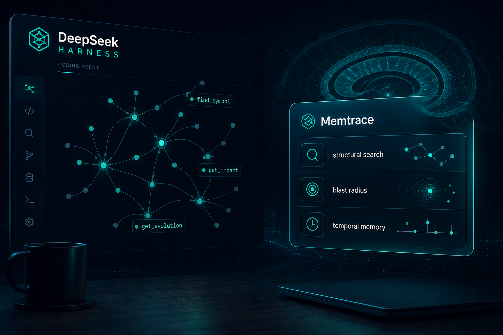
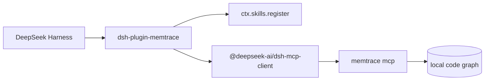

<p align="center">
  
</p>

<h1 align="center">Memtrace for DeepSeek Harness</h1>

<p align="center">
  <strong>The code intelligence graph, as a DeepSeek Harness plugin.</strong><br />
  Structural search · blast radius · temporal memory · 27 agent skills
</p>

<p align="center">
  <a href="https://github.com/deepseek-ai/deepseek-harness"></a>
  <a href="https://github.com/topics/dsh-plugin"></a>
  <a href="https://memtrace.io"></a>
</p>

<p align="center">
  <a href="LICENSE"></a>
  <a href="https://github.com/deepseek-ai/deepseek-harness"></a>
  <a href="https://www.npmjs.com/package/dsh-plugin-memtrace"></a>
  
  <a href="https://github.com/syncable-dev/dsh-plugin-memtrace/actions"></a>
</p>

<p align="center">
  <a href="README.md">English</a> · <a href="README.zh.md">简体中文</a>
</p>

<p align="center">
  
</p>

---

## What you get

One `dsh plugin add` wires [Memtrace](https://memtrace.io) into DeepSeek Harness:

| Surface | What the agent sees |
| --- | --- |
| **MCP tools** | `mcp__memtrace__find_symbol`, `mcp__memtrace__find_code`, `mcp__memtrace__get_impact`, `mcp__memtrace__get_evolution`, `mcp__memtrace__get_symbol_context`, … — the full Memtrace graph, namespaced by the official DSH MCP client |
| **Skills** | 27 Agent Skills (`memtrace-first`, `memtrace-search`, `memtrace-impact`, `memtrace-codebase-exploration`, fleet coordination, …) registered on `ctx.skills` |
| **Local-first** | The graph lives on your machine. No cloud index. No repo upload. |

Ask the agent: *"Index this repo, then show me the blast radius of `apply`."*

It should call Memtrace — not `grep`.

## Quick start

`dsh` is the [DeepSeek Harness](https://github.com/deepseek-ai/deepseek-harness) CLI (`@deepseek-ai/dsh`). Install that first — this plugin does not ship it.

```sh
# once
npm install -g @deepseek-ai/dsh

# then add Memtrace
dsh plugin --profile web add github:syncable-dev/dsh-plugin-memtrace

# no global install? same command via npx:
npx -y @deepseek-ai/dsh plugin --profile web add github:syncable-dev/dsh-plugin-memtrace

# 2. Restart the profile and confirm the layer
dsh --profile web --dump-config | grep -A4 'id: dsh-plugin-memtrace'
```

The row pins `command: memtrace` (override with `MEMTRACE_BIN`; for a zero-install fetch restate the row with `command: npx` and `args: ['-y', 'memtrace', 'mcp']`). One child serves the whole profile — give a project its own graph by restating the `mcp-memtrace` row in the profile's `cordis.patch.yml` with `cwd: <repo root>` (restate the whole row, DSH does not deep-merge).

Then open the Web UI and index the workspace:

> Use Memtrace to index this directory, then give me an architecture briefing.

## Install & uninstall

| Channel | Command |
| --- | --- |
| Git (`main`) | `dsh plugin --profile web add github:syncable-dev/dsh-plugin-memtrace#main` |
| npm | `dsh plugin --profile web add dsh-plugin-memtrace` |
| Local checkout | `dsh plugin --profile web add ./dsh-plugin-memtrace` |
| Uninstall | `dsh plugin --profile web remove dsh-plugin-memtrace` |

This package is plain ESM — no `prepare` script, no `allowBuilds` prompt.

## How it works



Two Cordis rows, both owned by this bundle:

1. **`dsh-plugin-memtrace`** — reads `skills/*/SKILL.md` and registers each skill at apply time. Unload disposes them.
2. **`mcp-memtrace`** — official MCP client, `serverName: memtrace`, stdio, `memtrace mcp` with the command pinned (`MEMTRACE_BIN`, else `memtrace` on PATH — no per-child npx fetch). No workspace flag: `memtrace mcp` anchors on its working directory and opens the repository's own `.memdb` — per project once the host keys MCP children per session workspace; per restated row today.

We do **not** patch the filesystem skill provider's config. That row is last-write-wins; runtime registration does not collide with other skill packs.

## Tools the model gets

After MCP discovery, every Memtrace tool is a native DSH tool under `mcp__memtrace__*`. The ones agents use first:

| Tool | Use when |
| --- | --- |
| `list_indexed_repositories` | Check what is already in the graph |
| `index_directory` | First contact with a repo |
| `find_symbol` / `find_code` | Locate a function, type, or behavior |
| `get_symbol_context` | Callers, callees, community |
| `get_impact` | Blast radius before an edit |
| `get_evolution` | What changed, and when |
| `recall_decision` | Why odd-looking code is there |

Full parameter spec: [`references/mcp-parameters.md`](references/mcp-parameters.md).

## Skills

| Skill | Triggers on |
| --- | --- |
| `memtrace-first` | Any code discovery / "how does this work" |
| `memtrace-index` | "index this project" |
| `memtrace-search` | "find this function" |
| `memtrace-impact` | "what breaks if I change this" |
| `memtrace-evolution` | "what changed last week" |
| `memtrace-codebase-exploration` | "I'm new here" |
| `memtrace-code-review` | PR review |
| `memtrace-incident-investigation` | "something broke" |
| `memtrace-fleet-*` | Multi-agent coordination |

All 27 bundles live under [`skills/`](skills/).

## Configuration

| Variable | Effect |
| --- | --- |
| `MEMTRACE_BIN` | Absolute path or command the MCP row launches instead of the `memtrace` on PATH (also the shipped launcher's preference) |

Override the MCP row in the profile's `cordis.patch.yml` if you already run a Streamable HTTP Memtrace endpoint — restate the whole `mcp-memtrace` config (DSH does not deep-merge).

MCP stdio carries no per-call session identity: one child receives every session's calls, so repository identity must travel with the process — `memtrace mcp` with no flags opens the `.memdb` anchored by its working directory (the project-editor pattern from `memtrace mcp --help`). dsh-mcp-client (0.2.2-rc.5) mounts one child per row with a static `cwd`, so per-session keying needs a host-side change; until then, restating the `mcp-memtrace` row with `cwd: <repo root>` gives that project its own child, its own store, and no split-brain refusal (memtrace still refuses to index a repo into a store other than the one that path resolves to).

## Compatibility

| Surface | Status |
| --- | --- |
| Harness | DeepSeek Harness `>=0.1.0-rc.6 <0.3.0` — verified against `0.2.2-rc.5` (current release) |
| Compat check | `engines.dsh` decides on DSH `0.2.1-alpha.3`+; older DSH reads the `@deepseek-ai/dsh` peer range |
| Node | `>=22.19.0` (DSH `0.2.x` itself requires Node `>=24.9`; the desktop app bundles its own runtime) |
| Platforms | macOS, Linux, Windows (Memtrace native binary via npm optional deps) |
| Network | None required after the Memtrace binary is present |

## Permissions & data

- Spawns `memtrace mcp` (`MEMTRACE_BIN` overrides the command); the per-project working directory comes from the session-workspace keying described above, or your restated row's `cwd` (reads the repo to index; writes `.memdb` next to the project).
- Registers skills from this package only.
- Does not send code to Memtrace cloud. Local graph.

## Topics

[`dsh`](https://github.com/topics/dsh) · [`dsh-plugin`](https://github.com/topics/dsh-plugin) · [`deepseek-harness`](https://github.com/topics/deepseek-harness) · [`cordis`](https://github.com/topics/cordis) · [`memtrace`](https://github.com/topics/memtrace) · [`mcp`](https://github.com/topics/mcp)

## License

[MIT](LICENSE) © 2026 Memtrace / Syncable

Community-maintained Harness plugin. Not an official DeepSeek product.
