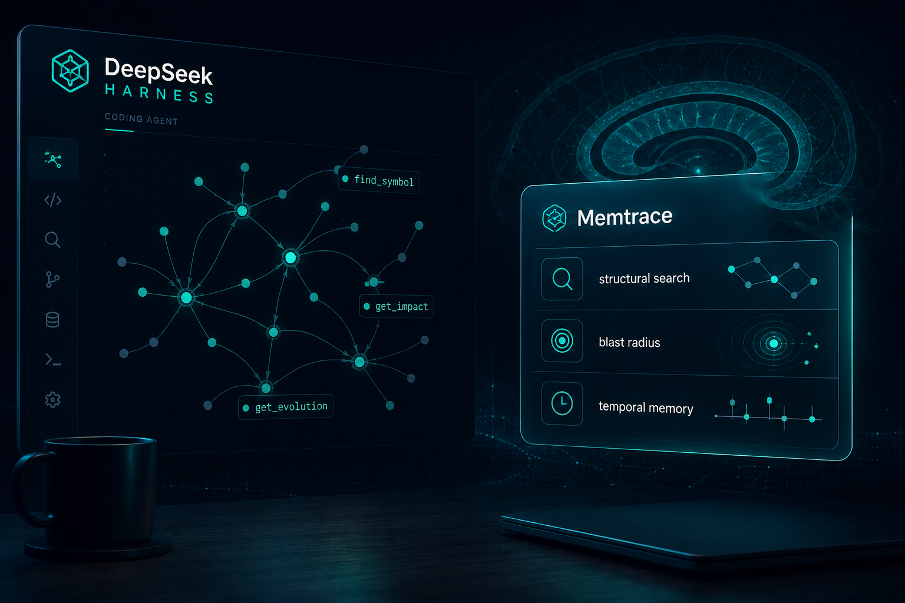

<p align="center">
  
</p>

<h1 align="center">Memtrace for DeepSeek Harness</h1>

<p align="center">
  <strong>把代码智能图谱做成 DeepSeek Harness 插件。</strong><br />
  结构化搜索 · 爆炸半径 · 时序记忆 · 27 个 Agent Skill
</p>

<p align="center">
  <a href="https://github.com/deepseek-ai/deepseek-harness"></a>
  <a href="https://github.com/topics/dsh-plugin"></a>
  <a href="https://memtrace.io"></a>
</p>

<p align="center">
  <a href="LICENSE"></a>
  <a href="https://github.com/deepseek-ai/deepseek-harness"></a>
  <a href="https://www.npmjs.com/package/dsh-plugin-memtrace"></a>
  
</p>

<p align="center">
  <a href="README.md">English</a> · <a href="README.zh.md">简体中文</a>
</p>

<p align="center">
  
</p>

---

## 你得到什么

一条 `dsh plugin add` 把 [Memtrace](https://memtrace.io) 接到 DeepSeek Harness：

| 能力 | Agent 看到的 |
| --- | --- |
| **MCP 工具** | `mcp__memtrace__find_symbol`、`get_impact`、`get_evolution`、`get_symbol_context` … — 完整图谱，经官方 DSH MCP 客户端加命名空间 |
| **Skills** | 27 个 Agent Skill（`memtrace-first`、搜索、爆炸半径、代码库探索、多 Agent 协同 …）注册到 `ctx.skills` |
| **本地优先** | 图谱在你的机器上。不上传仓库。 |

对 Agent 说：*「先索引这个仓库，然后给出 `apply` 的爆炸半径。」*

它应该走 Memtrace，而不是 `grep`。

## 快速开始

`dsh` 是 [DeepSeek Harness](https://github.com/deepseek-ai/deepseek-harness) 的 CLI（`@deepseek-ai/dsh`）。先装 Harness，本插件不带这个命令。

```sh
npm install -g @deepseek-ai/dsh
dsh plugin --profile web add github:syncable-dev/dsh-plugin-memtrace

# 不装全局 CLI 也可以：
npx -y @deepseek-ai/dsh plugin --profile web add github:syncable-dev/dsh-plugin-memtrace

dsh --profile web --dump-config | grep -A4 'id: dsh-plugin-memtrace'
```

row 固定 `command: memtrace`（用 `MEMTRACE_BIN` 覆盖；零安装可整行重述为 `command: npx`、`args: ['-y', 'memtrace', 'mcp']`）。一个 child 服务整个 profile —— 想让某个项目有自己的图谱，在 profile 的 `cordis.patch.yml` 里整行重述 `mcp-memtrace` 并设 `cwd: <仓库根目录>`（DSH 不做深度合并，需重述整行）。

然后在 Web UI 里：

> 用 Memtrace 索引当前目录，然后给我一份架构简报。

## 安装与卸载

| 渠道 | 命令 |
| --- | --- |
| Git | `dsh plugin --profile web add github:syncable-dev/dsh-plugin-memtrace#main` |
| npm | `dsh plugin --profile web add dsh-plugin-memtrace` |
| 卸载 | `dsh plugin --profile web remove dsh-plugin-memtrace` |

本包是纯 ESM，没有 `prepare`，git 安装不需要 `allowBuilds`。

## 兼容性

- DeepSeek Harness `>=0.1.0-rc.6 <0.3.0`（已对照当前版本 `0.2.2-rc.5` 验证）。
- DSH `0.2.1-alpha.3+` 以 `engines.dsh` 判定兼容；更早的 DSH 读取 `@deepseek-ai/dsh` peer 范围。
- Node `>=22.19.0`（DSH `0.2.x` 自身要求 Node `>=24.9`；桌面应用自带运行时）。

## 工作原理

两条 Cordis 行，都由本包拥有：

1. **`dsh-plugin-memtrace`** — 读取 `skills/*/SKILL.md`，在 `apply` 时注册；卸载即注销。
2. **`mcp-memtrace`** — 官方 MCP 客户端，`serverName: memtrace`，`memtrace mcp`，命令固定（`MEMTRACE_BIN`，否则 PATH 上的 `memtrace` —— 不会按 child 重复拉取 npx）。不带 workspace 旗标：`memtrace mcp` 以其工作目录为锚，打开仓库自己的 `.memdb` —— 等 host 按会话 workspace 启动 child 后即为按项目；当前则靠整行重述本 row。

不会去改文件系统 skill provider 的 `config`（整行覆盖、后写赢）。运行时注册不会和其他 skill 包打架。

MCP stdio 不携带每次调用的会话身份：一个 child 收到所有会话的调用，仓库身份必须随进程传递 —— 不带旗标的 `memtrace mcp` 打开由其工作目录锚定的 `.memdb`（`memtrace mcp --help` 的 project-editor 模式）。dsh-mcp-client（0.2.2-rc.5）按 row 挂一个静态 `cwd` 的 child，按会话 keying 需要 host 侧改动；在此之前，整行重述 `mcp-memtrace` 并设 `cwd: <仓库根目录>` 即可让该项目拥有自己的 child、自己的 store，也不会触发防脑裂拒绝。

## 许可证

[MIT](LICENSE) © 2026 Memtrace / Syncable

社区维护的 Harness 插件，**不是** DeepSeek 官方产品。
