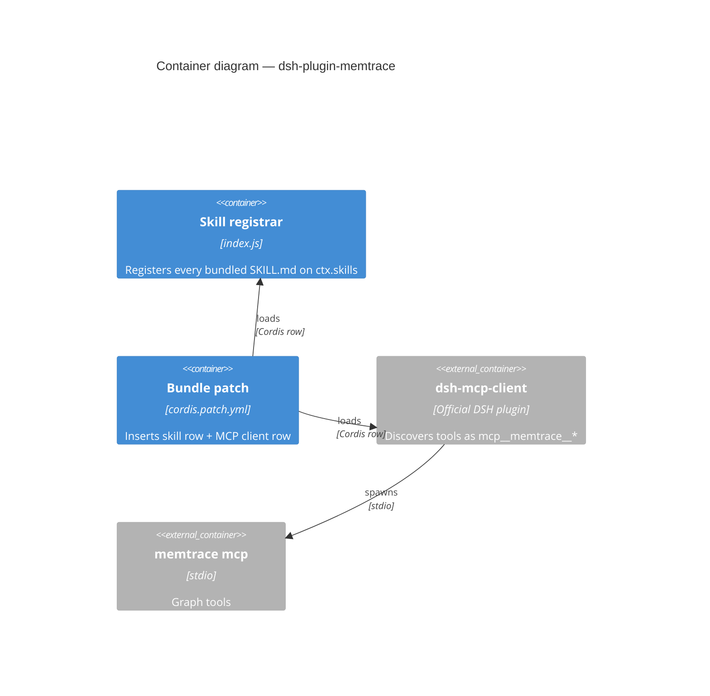

# Building block view

C4 Level 2 — deployables inside this bundle.

C4 Level 3 — folders in this package, matching screaming architecture:

| Folder | Responsibility |
| --- | --- |
| `lib/` | Skill parse/load, Cordis apply factory |
| `skills/` | One Memtrace workflow per directory |
| `references/` | Shared MCP parameter spec for skill bodies |
| `assets/` | Icon, hero, social preview |
| `docs/` | arc42 |
| `test/` | Fast node:test suite |
